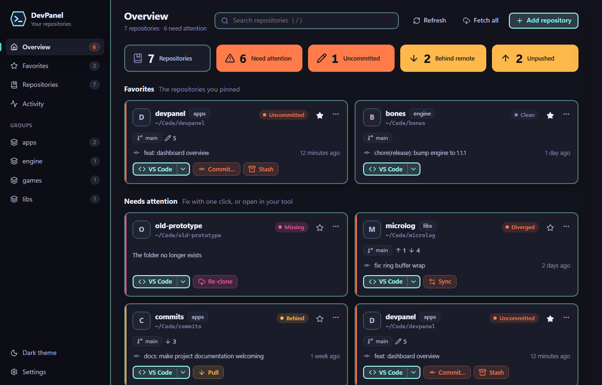

# DevPanel

[](#built-with-ai-assistance)

A desktop dashboard for the git repositories you work on. Add them once, then see at a glance which ones need a pull, a push or a commit, fix them in one click, open them in VS Code, Claude Code or Commits, and run their install scripts — without a terminal or a file explorer.

Inspired by Microsoft's discontinued Dev Home, built on the [bones](https://github.com/an-dr/bones) engine.



## What it does

| Area | You can |
| --- | --- |
| Track | Clone from a URL, add a local folder, or scan a folder and add every repository under it. Group repositories and rename them |
| See | The condition of every repository: branch, upstream, ahead/behind, staged/modified/untracked/conflicted files, stashes, last commit, unfinished merges or rebases, missing folders |
| Fix | One-click suggested fixes — pull, push, sync, publish a new branch, commit all, stash, re-clone a missing folder — plus fetch, pull, push and sync on demand, or for all at once |
| Open | Each repository in any tool you configure. VS Code, Claude Code (in a terminal), Commits, a terminal and the file manager are set up by default — or its web page on GitHub, GitLab, Bitbucket and other hosts |
| Install | Run the install or build script a repository ships (`install.ps1`, `install.sh`, `scripts/…`), an ecosystem default (`cargo install`, `npm install`, …), or your own command, and watch its output live |

## Getting it

**Download** the zip for your platform — Linux x64, Windows x64 or Windows ARM64 — from the [latest release](https://github.com/an-dr/dev-panel/releases/latest), unzip it, and run `devpanel-app`. To keep it, click **Install** in Settings → Installation, or run:

```sh
devpanel-app --install
```

That installs to `~/.devpanel/app` and adds DevPanel to the application menu or Start menu. It also installs [Commits](https://github.com/an-dr/commits), DevPanel's git client, when Commits is not installed yet; an existing Commits is left alone, since it updates itself. Bundling Commits makes each zip about 25 MB larger. The Linux build needs WebKitGTK 4.1 and GTK 3, which most desktops already have.

**From source**, it needs a Rust toolchain, a C compiler with CMake (bones builds SDL3), and `git` on `PATH`; Linux also needs the WebKitGTK development packages. With Visual Studio 2026 installed, CMake must be 4.2 or newer: the build picks the newest Visual Studio generator, and older CMake fails with "Could not create named generator Visual Studio 18 2026". PowerShell 7 runs the helper scripts.

```sh
git clone --recurse-submodules https://github.com/an-dr/dev-panel.git
cd dev-panel
pwsh scripts/install.ps1
```

That builds a release, installs it to `~/.devpanel/app`, and adds DevPanel to the application menu on Linux or the Start menu on Windows, with "Open in DevPanel" on folders. Run it again after pulling to update: the new build goes into a new version folder and starts next time, while the running one is left alone. [docs/installation.md](docs/installation.md) explains the layout, which is the same as Commits uses.

To run without installing: `cargo run --release -p devpanel`.

Your repositories, tools and settings live in one JSON file — `~/.config/devpanel/workspace.json` on Linux, `%APPDATA%\devpanel\workspace.json` on Windows, `~/Library/Application Support/devpanel/workspace.json` on macOS — outside the install, so updates keep them.

## Using it

- **Add repository** (Ctrl+N) — clone, add a folder, or scan a folder.
- **Overview** shows totals, your favorites, and every repository that needs attention; its suggested fixes sit in the details panel.
- **Names** appear in pixel, cyber, tech and chip display fonts, picked per repository; Edit… changes the font, weight and italic.
- **Favorite** a repository with the star on its card to pin the ones you work with most — they sort first and get their own section.
- Click a card to open its details: suggested fixes, changed files, every git action, tools, install, recent output.
- **Drag** a card onto Favorites or a group in the sidebar to put it there, and drag sidebar items to reorder them. Settings → **Start on** picks the page DevPanel opens on: the one you were on, or any page or group.
- **Activity** keeps the output of everything DevPanel ran.
- **Settings** installs DevPanel when it runs from a download, sets the clone folder, the default tool, automatic fetching, the theme, the **density** (compact, comfortable or spacious), the tool list, and **exports or imports** your repository list to move it to another machine and clone everything there.
- `/` searches, Ctrl+R refreshes, Esc closes whatever is open.
- `devpanel <folder>` adds that repository, or every repository under the folder, and opens it. DevPanel keeps one window: a second launch hands its folder to the running one and brings it to the front.

Status is read when DevPanel starts, when its window regains focus, after every action, and whenever git changes in a repository — a commit or checkout made in a terminal shows up within a second. "Behind" is only as fresh as the last fetch: use **Fetch all**, or turn on automatic fetching.

## Platforms

Linux x64, Windows x64 and Windows ARM64 are built and tested by [CI](docs/ci.md) on every push. Day-to-day use has been on Linux (Pop!_OS 24.04, COSMIC via Xwayland); the Windows desktop paths — terminals, Start menu, `.cmd` shims — pass the tests but have not been clicked through by a person, and macOS is not built. See [VERIFY.md](VERIFY.md).

## Documentation

[docs/index.md](docs/index.md) is the map: architecture, the domain rules behind the health verdict, the page protocol, development, and decisions.

## Built with AI assistance

DevPanel is written with the help of AI coding assistants, and every change is reviewed and committed by its maintainer. Commits do not name an assistant as a co-author; [CI](docs/ci.md#co-author-check) rejects ones that do.

## License

MIT.
