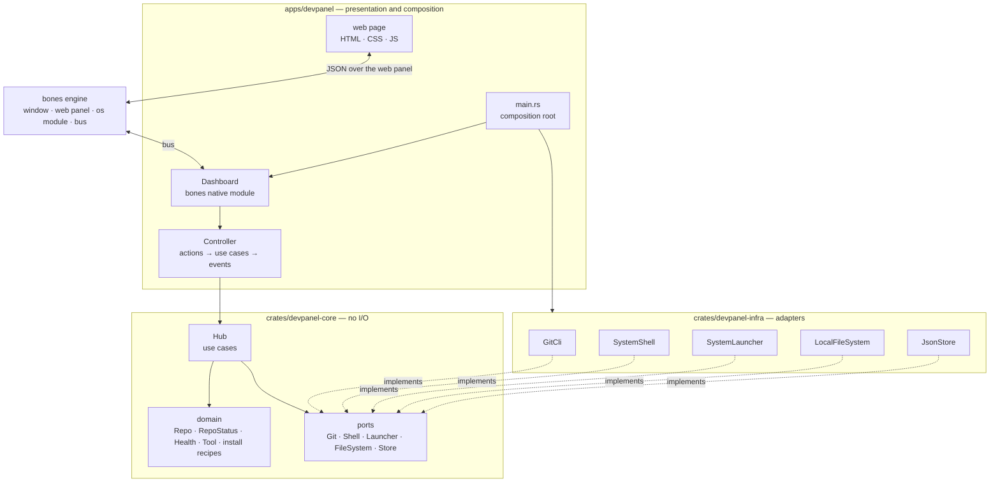
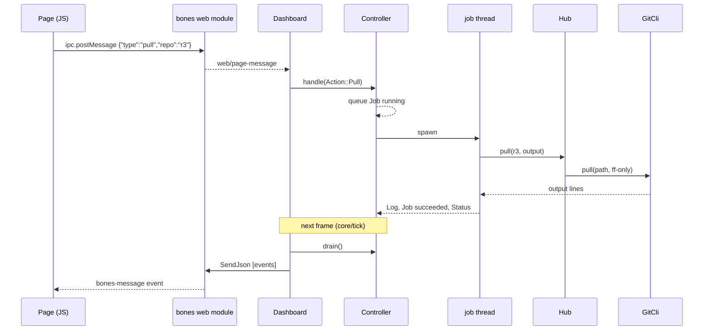

# Architecture

DevPanel is a clean-architecture application in three crates and a web page, hosted by the bones engine.

## Layers

| Crate | Holds | Depends on |
| --- | --- | --- |
| `devpanel-core` | Entities, the rules that judge them, the `Hub` use cases, and the port traits | `serde` only |
| `devpanel-infra` | One adapter per port: `git` CLI, platform shell, tool launcher, filesystem, JSON file | `devpanel-core` |
| `devpanel` (app) | The bones module, the controller, the page protocol, the page itself, and `main` | all of the above and `bones-engine` |

The dependency rule points inward. `devpanel-core` names no adapter and no engine, so every rule in it is tested with in-memory fakes. Only `main.rs` knows every concrete type; only `dashboard.rs` speaks the bones bus.

## Why the app is a native module

The bones way to build a product is a sandboxed WASM extension. DevPanel's work is the opposite of sandboxed — run `git`, launch editors, read arbitrary folders — so the whole product lives in one native module, and the page is the only UI ([ADR-001](adr/ADR-001-one-native-module-no-wasm-guest.md)). Everything the engine already offers is used rather than rebuilt: the window, the web panel, the folder picker, opening URLs, and the clipboard via the `os` module.

## An action, end to end

The frame thread never waits on git. The controller queues events on a channel from any thread; on every `core/tick` the dashboard drains them and sends one JSON batch to the page.

## Threads

| Work | Runs on | Why |
| --- | --- | --- |
| Page messages, quick use cases (add, edit, open a tool, list recipes) | frame thread | They finish in milliseconds |
| Status reads | a pool of 4 | Refreshing fifty repositories must not start fifty `git` processes at once |
| "Fetch all" | a pool of 4 | Same, for the network |
| Clone, pull, push, sync, commit, stash, install, run | one thread each | Few, possibly long, and must not queue behind each other |

Two jobs never run in the same repository at once: the second is refused, since two `git` processes in one working tree only fight over its lock. The workspace sits behind one mutex that is never held while a command runs.

## State

The workspace — tracked repositories, tools and settings — is one JSON document, loaded at start and rewritten atomically after every change. A change that fails to save is rolled back in memory too. Repository status is never stored: it is read from git every time.

## Linux display

bones embeds GTK webviews as children of the SDL window, which only works on X11. `main` points both SDL and GTK at X11 (Xwayland on Wayland desktops), overriding a session-wide `GDK_BACKEND=wayland`. Programs DevPanel launches get the user's original values back, so an editor starts exactly as it would from a shell.
