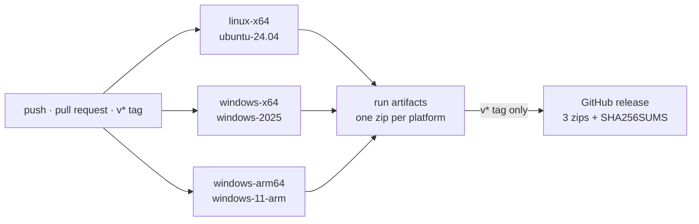

# Continuous integration

[`.github/workflows/build.yml`](../.github/workflows/build.yml) builds, tests and packages DevPanel on every push and pull request, and publishes a release for every `v*` tag.



## One job per platform, on that platform

Each platform builds on a runner of its own operating system and architecture, so every binary is compiled by its native toolchain and every test suite runs where the binary will. Each job runs the same steps a developer would:

| Step | Command |
| --- | --- |
| Test | `cargo test --workspace --release` |
| Build | `scripts/dist.ps1` |
| Package | `scripts/package-release.ps1 -Platform <platform> -Tag <tag>` |

Tests use the release profile so the build step reuses their artifacts instead of compiling everything twice. Rust is installed on the ARM runner, whose image lacks it; the other runners already have `rustup`. `Swatinem/rust-cache` keeps dependencies between runs, one cache per platform.

This differs from Commits, which cross-compiles both Windows targets from Linux inside one Docker image. Native runners need no cross toolchain, Windows SDK download or compiler wrapper. More importantly, they run the full test suite on Windows x64 and Windows ARM64, not only on Linux. The cost is that a Windows build cannot be reproduced on a Linux machine; it needs Windows, or the workflow's own run.

## Artifacts and releases

Every run uploads `devpanel-<version>-<platform>.zip` per platform, downloadable from the run page for 30 days. A tag `v<version>` additionally publishes all three zips and a `SHA256SUMS` file as a GitHub release with generated notes. `package-release.ps1` refuses a tag that does not match `[workspace.package] version`, so a release can never hold binaries that report another version.

Each zip holds a `devpanel/` folder in the [install layout](installation.md). Run `devpanel` from it directly, or install it for the current user:

```sh
devpanel/<version>/devpanel-app --install
```

## Releasing

1. Bump `version` in `Cargo.toml` and `UPGRADER_LAUNCHER_VERSION` in `.cargo/config.toml` together.
2. Commit and push to `main`, and wait for the build to pass.
3. Tag and push: `git tag v<version> && git push origin v<version>`.
