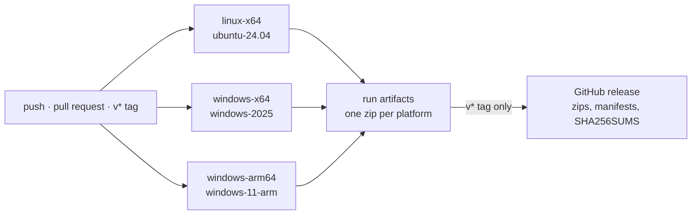

# Continuous integration

[`.github/workflows/build.yml`](../.github/workflows/build.yml) builds, tests and packages DevPanel on every push and pull request, and publishes a release for every `v*` tag.



## One job per platform, on that platform

Each platform builds on a runner of its own operating system and architecture, so every binary is compiled by its native toolchain and every test suite runs where the binary will. Each job runs the same steps a developer would:

| Step | Command |
| --- | --- |
| Test | `cargo test --workspace --release` |
| Test the Commits fetch | `scripts/fetch-commits.tests.ps1` |
| Build | `scripts/dist.ps1 -Platform <platform> -RequireCommits` |
| Package | `scripts/package-release.ps1 -Platform <platform> -Tag <tag>` |

Tests use the release profile so the build step reuses their artifacts instead of compiling everything twice. Rust is installed on the ARM runner, whose image lacks it; the other runners already have `rustup`. `Swatinem/rust-cache` keeps dependencies between runs, one cache per platform.

This differs from Commits, which cross-compiles both Windows targets from Linux inside one Docker image. Native runners need no cross toolchain, Windows SDK download or compiler wrapper. More importantly, they run the full test suite on Windows x64 and Windows ARM64, not only on Linux. The cost is that a Windows build cannot be reproduced on a Linux machine; it needs Windows, or the workflow's own run.

## Bundling Commits

`dist.ps1` calls `scripts/fetch-commits.ps1`, which downloads `commits-<platform>.json` from the Commits release `v<COMMITS_VERSION>` (pinned in `.cargo/config.toml`), then the archive it names, and checks the archive against the manifest's `sha256`. Both go into the version folder's `companions/`. In CI, `-RequireCommits` makes any failure, including a checksum mismatch, fail the build, and `package-release.ps1` refuses a folder without the manifest. `fetch-commits.tests.ps1` checks the mismatch path offline with a stand-in release. To bundle a newer Commits, change the pin; nothing else names the version.

## Artifacts and releases

Every run uploads, per platform, `devpanel-<version>-<platform>.zip` and its manifest `devpanel-<platform>.json`, downloadable from the run page for 30 days. A tag `v<version>` additionally publishes all of them and a `SHA256SUMS` file as a GitHub release. Its notes are `docs/releases/<version>.md` when that file exists, generated otherwise. The manifests are what a running DevPanel's update check reads from the latest release ([installation.md](installation.md#updating)). `package-release.ps1` refuses a tag that does not match `[workspace.package] version`, so a release can never hold binaries that report another version.

The zip is one version folder, and it is both the download and the update payload ([installation.md](installation.md#the-release-zip)). Unzip it and run `devpanel-app`, then install it from Settings → Installation or with:

```sh
devpanel-app --install
```

## Releasing

1. Bump `version` in `Cargo.toml` and `UPGRADER_LAUNCHER_VERSION` in `.cargo/config.toml` together, and write the notes in `docs/releases/<version>.md`.
2. Commit and push to `main`, and wait for the build to pass.
3. Tag and push: `git tag v<version> && git push origin v<version>`.
