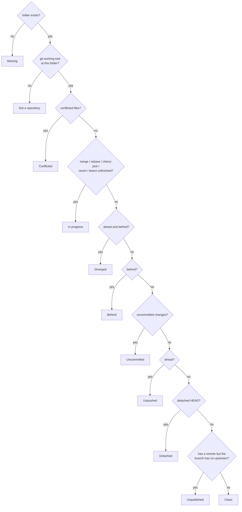

# Domain rules

The rules `devpanel-core` applies to what git reports. They are the product's opinions, so they live here and in one place in code each.

## Health

Each repository gets exactly one verdict, the most urgent that applies. Checks run in this order and the first match wins:

A folder inside another repository is *not a repository*: the working tree's top level must be the tracked folder itself. A repository with no commits yet, or with no remote at all, is *clean* — there is nothing it could be out of step with.

"Behind" counts only what the last fetch saw. DevPanel fetches only when asked, or on the interval set in Settings.

### Verdicts

The verdicts, their order, rules, labels and urgencies are Commits' [repository-health contract](https://github.com/an-dr/commits/blob/main/docs/repository-health.md), and that page is the authority. This table describes what DevPanel shows: the id is what the [protocol](protocol.md) carries, the label is what the user reads, and the urgency picks the colour ([colours.md](colours.md#dark-cockpit)).

DevPanel keeps its own implementation, `Health::of`, and proves it matches by running Commits' conformance vectors: `crates/devpanel-core/tests/health_vectors.rs` checks every case's verdict and the verdict order, and a test in `protocol.rs` checks the page's labels. A copy of the vectors sits beside that test, with the Commits release it came from. Any mismatch is DevPanel's bug.

| Id | Label | Urgency |
| --- | --- | --- |
| `missing` | Missing | warning |
| `not-a-repo` | Not a repository | warning |
| `conflicted` | Conflicts | warning |
| `in-progress` | In progress | caution |
| `diverged` | Diverged | caution |
| `behind` | Behind | advisory |
| `dirty` | Uncommitted | caution |
| `ahead` | Unpushed | advisory |
| `detached` | Detached HEAD | caution |
| `unpublished` | Unpublished | advisory |
| `clean` | Clean | normal |

## Fixes

The verdict picks the badge; the fixes are every action that would improve the repository, most useful first. A repository can be behind *and* dirty, and it is offered both.

| Condition | Fix offered | What runs |
| --- | --- | --- |
| Folder missing and a remote URL is known | Re-clone | `git clone <remote> <path>` |
| Conflicts or an unfinished operation | Resolve | Opens the default tool; nothing is automated |
| Uncommitted changes | Commit… | `git add --all`, `git commit -m <message>` |
| Behind only | Pull | `git pull --ff-only` |
| Ahead only | Push | `git push` |
| Ahead and behind, clean tree | Sync | `git pull --rebase`, then `git push` |
| Branch without upstream, remote exists | Publish | `git push -u <remote> HEAD` |
| Uncommitted changes | Stash | `git stash push --include-untracked` |

A plain pull only fast-forwards. Anything else needs a decision — merge or rebase — that the dashboard does not take silently; Sync is the explicit choice of rebase. Sync is withheld while the tree is dirty, because rebasing over uncommitted work is how work gets lost.

Remote URLs are remembered from every status read, so a repository that later disappears can still be re-cloned. `origin` is preferred; otherwise the first remote.

## Install recipes

"Install" proposes commands from the files in the repository's root and in `scripts/` and `tools/`, in this order:

1. The repository's own install command, if one was saved with Edit.
2. `install` and `setup` scripts in the root, then `scripts/`, then `tools/`: `.ps1` everywhere (run with `pwsh`), `.sh` on Linux and macOS, `.cmd` or `.bat` on Windows.
3. Ecosystem defaults: `cargo install --path .`, `npm install`, `pip install -e .` (or `-r requirements.txt`), `go install ./...`, a CMake configure and build, and `make install` outside Windows.

The repository's author knows best, so their scripts come first. Scripts for the other platform are left out rather than offered and failing. Every recipe runs through the platform shell in the repository folder, with no terminal attached: anything that waits for input fails instead of hanging.

## Web page

The globe button opens a repository's page on its host. The address comes from the remote: `origin`, or the remembered clone URL when git reports none. The host and path become `https://host/path` with `.git`, user names, passwords and SSH ports removed. That one rule fits GitHub, GitLab with nested groups and on its own servers, Bitbucket, Codeberg, Gitea, Forgejo and sourcehut. Azure DevOps is the one host whose SSH path differs from its page, `v3/org/project/repo` against `org/project/_git/repo`, and is translated. A local or `file://` remote has no page, and the button is hidden.

An address saved with Edit wins over the derived one. It is for a host neither rule fits, or a page other than the repository's front, and it travels with the repository list on export.

## Name style

Each repository's name is set in one of the bundled display fonts ([development.md](../development.md#display-fonts)), so cards tell apart at a glance without a letter badge. A repository nobody styled gets a font, one of that font's real weights, and italic only where the font has a real italic, all derived from its id: the same on every start and every machine, and never stored. Edit… stores a chosen `name_style` — a font id (empty for the plain interface font), a weight and italic — and choosing Automatic again with its own weight and slant clears it. With Settings → New repositories set to the plain font, a newly tracked or imported repository is stored with the plain style instead, for users who style each one by hand. The core keeps the style as opaque data; only the page knows the fonts, and an unknown font falls back to the plain one.

## Tools

A tool is a named way to open a repository:

| Kind | Starts |
| --- | --- |
| Program | `program args…`, with `{path}` in arguments replaced by the repository path and the repository as working directory. `~` and `PATH` resolve as in a shell; on Windows a name without an extension tries the `PATHEXT` extensions first, so `code` finds `code.cmd` rather than VS Code's extensionless shell script |
| Terminal | A terminal at the repository, optionally running a command and then leaving a shell open |
| File manager | The system file manager at the repository |
| App | A desktop app that takes no folder, by its Windows AppUserModelID (`Claude_pzs8sxrjxfjjc!Claude`) or macOS application name; the repository is ignored |

Tools start detached: closing DevPanel never closes the editor it opened. Defaults are VS Code (`code`), Cursor, Windsurf, Zed, Claude Code and Codex CLI (in a terminal), the Claude and ChatGPT desktop apps on Windows and macOS, Commits (`~/.commits/app/commits`), a terminal and the file manager. Defaults added in a later version reach an existing workspace once (`settings.tool_defaults`), so a removed default does not return.

Each tool can be turned off. The page offers a tool only when it is on and installed: its program, or a terminal tool's command, resolves, or an app tool's package or bundle exists. Availability is checked again whenever the window regains focus.

On Linux the terminal is `$TERMINAL` when it is a known one, else the system's `x-terminal-emulator`, else the first installed of cosmic-term, GNOME Terminal, Ptyxis, Konsole, kitty, Alacritty, WezTerm, foot, Xfce Terminal and xterm. Windows uses Windows Terminal when present and `cmd` otherwise; macOS uses Terminal.app.
