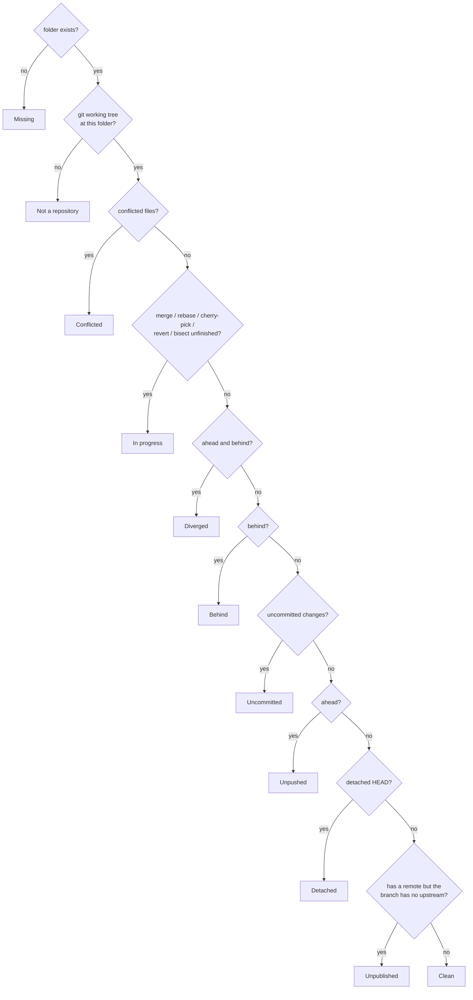

# Domain rules

The rules `devpanel-core` applies to what git reports. They are the product's opinions, so they live here and in one place in code each.

## Health

Each repository gets exactly one verdict, the most urgent that applies. Checks run in this order and the first match wins:

A folder inside another repository is *not a repository*: the working tree's top level must be the tracked folder itself. A repository with no commits yet, or with no remote at all, is *clean* — there is nothing it could be out of step with.

"Behind" counts only what the last fetch saw. DevPanel fetches only when asked, or on the interval set in Settings.

## Fixes

The verdict picks the badge; the fixes are every action that would improve the repository, most useful first. A repository can be behind *and* dirty, and it is offered both.

| Condition | Fix offered | What runs |
| --- | --- | --- |
| Folder missing and a remote URL is known | Re-clone | `git clone <remote> <path>` |
| Conflicts or an unfinished operation | Resolve | Opens the default tool; nothing is automated |
| Uncommitted changes | Commit… | `git add --all`, `git commit -m <message>` |
| Behind only | Pull | `git pull --ff-only` |
| Ahead only | Push | `git push` |
| Ahead and behind, clean tree | Sync | `git pull --rebase`, then `git push` |
| Branch without upstream, remote exists | Publish | `git push -u <remote> HEAD` |
| Uncommitted changes | Stash | `git stash push --include-untracked` |

A plain pull only fast-forwards. Anything else needs a decision — merge or rebase — that the dashboard does not take silently; Sync is the explicit choice of rebase. Sync is withheld while the tree is dirty, because rebasing over uncommitted work is how work gets lost.

Remote URLs are remembered from every status read, so a repository that later disappears can still be re-cloned. `origin` is preferred; otherwise the first remote.

## Install recipes

"Install" proposes commands from the files in the repository's root and in `scripts/` and `tools/`, in this order:

1. The repository's own install command, if one was saved with Edit.
2. `install` and `setup` scripts in the root, then `scripts/`, then `tools/`: `.ps1` everywhere (run with `pwsh`), `.sh` on Linux and macOS, `.cmd` or `.bat` on Windows.
3. Ecosystem defaults: `cargo install --path .`, `npm install`, `pip install -e .` (or `-r requirements.txt`), `go install ./...`, a CMake configure and build, and `make install` outside Windows.

The repository's author knows best, so their scripts come first. Scripts for the other platform are left out rather than offered and failing. Every recipe runs through the platform shell in the repository folder, with no terminal attached: anything that waits for input fails instead of hanging.

## Tools

A tool is a named way to open a repository:

| Kind | Starts |
| --- | --- |
| Program | `program args…`, with `{path}` in arguments replaced by the repository path and the repository as working directory. `~` and `PATH` resolve as in a shell; on Windows `PATHEXT` finds `code.cmd` from `code` |
| Terminal | A terminal at the repository, optionally running a command and then leaving a shell open |
| File manager | The system file manager at the repository |

Tools start detached: closing DevPanel never closes the editor it opened. Defaults are VS Code (`code`), Claude Code (`claude` in a terminal), Commits (`~/.commits/app/commits`), a terminal and the file manager.

On Linux the terminal is `$TERMINAL` when it is a known one, else the system's `x-terminal-emulator`, else the first installed of cosmic-term, GNOME Terminal, Ptyxis, Konsole, kitty, Alacritty, WezTerm, foot, Xfce Terminal and xterm. Windows uses Windows Terminal when present and `cmd` otherwise; macOS uses Terminal.app.
