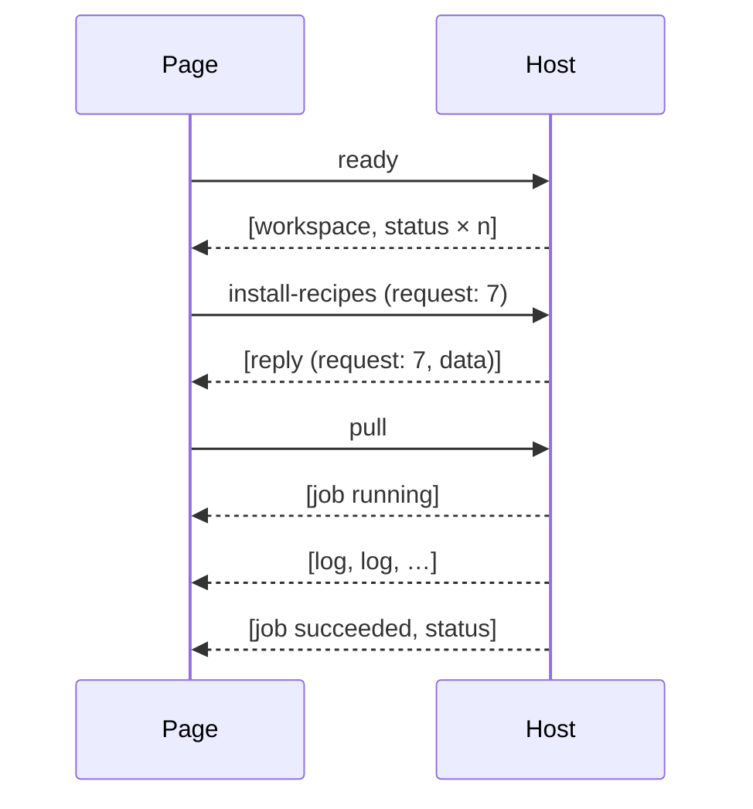

# Page protocol

The page and the host exchange JSON objects, each with a `type`. The page sends one object per `window.ipc.postMessage`; the host sends a JSON **array** of objects per frame, delivered as the `detail` of a `bones-message` window event. The Rust side of this contract is `apps/devpanel/src/protocol.rs`.

## Page → host

| `type` | Fields | Effect |
| --- | --- | --- |
| `ready` | — | Sends the workspace and refreshes every status |
| `refresh` | `repo?` | Re-reads status of one repository, or all |
| `fetch` | `repo?` | Fetches one repository, or every one with a remote |
| `pull` · `push` · `sync` · `stash` | `repo` | Runs that git operation as a job |
| `commit` | `repo`, `message` | Stages everything and commits |
| `fix` | `repo`, `fix`, `message?` | Runs one suggested fix (`reclone`, `pull`, `sync`, `push`, `publish`, `commit-all`, `stash`, `open-in-tool`) |
| `open` | `repo`, `tool?` | Opens the repository in a tool, the default when absent |
| `open-in-commits` | `repo`, `theme` | Opens the repository in Commits on the view its verdict calls for, in `light` or `dark`: the theme the page shows, with "follow the system" already resolved ([commits.md](commits.md)) |
| `add-existing` | `path` | Tracks a local repository |
| `scan` | `path` | Tracks every repository under a folder, as a job |
| `clone` | `url`, `parent?` | Clones into `parent` or the clone folder, as a job |
| `remove` | `repo` | Stops tracking; files stay on disk |
| `edit` | `repo`, `name`, `group?`, `install_command?`, `web_url?`, `name_style?` | Updates a repository's settings; an empty value clears it |
| `favorite` | `repo`, `favorite` | Pins a repository as a favourite, or clears the mark |
| `set-group` | `repo`, `group?` | Moves a repository into a group, or out of every group when absent |
| `export` | `folder` | Writes a portable repository list (`devpanel-repos.json`) into `folder` |
| `import` | `folder`, `dest?` | Reads the list in `folder` and clones every repository into `dest` or the clone folder, as a job |
| `install-recipes` | `request`, `repo` | Answered with a `reply` holding the recipe list |
| `run` | `repo`, `command`, `title?` | Runs a shell command in the repository, as a job |
| `save-settings` | `settings` | Replaces the settings |
| `save-tools` | `tools` | Replaces the tool list |
| `pick-folder` | `request` | Native folder dialog; `reply` data is the path, or `""` when cancelled |
| `open-url` | `url` | Opens the system browser |
| `copy` | `text` | Writes the clipboard |
| `update` | `request`, `action` | Looks for a newer release (`check`) or downloads it into a new version folder for the next start (`stage`); `reply` data is `{available}`, `{staged}`, or `{}` when up to date. Nothing installs without the user's click |
| `desktop` | `request`, `action` | Registers DevPanel with the desktop (`register`), removes it (`unregister`), or asks (`status`); `reply` data is whether it is registered afterwards |
| `installation` | `request`, `action` | Asks where DevPanel stands (`status`), or installs the running build (`install`) the way `devpanel-app --install` does; `reply` data is `{installed, current, dir}` — the installed version or `null`, whether the running build is that install, and the install folder — and, after `install`, `report`, the lines the install printed |

`pick-folder`, `open-url` and `copy` are answered by the bones `os` module, `update` by its `upgrader` module and `desktop` by its `desktop` module; the rest, `installation` included, by the controller.

## Host → page

| `type` | Fields | Meaning |
| --- | --- | --- |
| `workspace` | `workspace`, `platform`, `version`, `commits` | Everything persisted: `repos`, `tools`, `settings`; `version` is the app's own; `commits` is whether "Open in Commits" can work: the Commits tool exists and its program is installed. Sent at start, after any change to them, and on a focus refresh when `commits` changed |
| `status` | `repo`, `status`, `health`, `fixes`, `web_url` | A fresh status read with its verdict, and the web page derived from the remote, or `null` ([domain.md](domain.md)) |
| `job` | `job`, `repo?`, `title`, `state`, `error?` | A job started (`running`) or ended (`succeeded`, `failed`) |
| `log` | `job`, `line` | One line of a job's output |
| `reply` | `request`, `ok`, `data`, `error?` | The answer to a request-carrying message |
| `toast` | `level`, `message` | A notice for the user: `info` or `error` |
| `select` | `repo` | Select this repository and open its drawer. Sent after `devpanel <path>` opened a folder, at startup or from a later launch |

A job's output arrives between its `running` and final `job` events. A job on a repository is always followed by that repository's `status`; a job that changes what is tracked is followed by `workspace` and every `status`.
