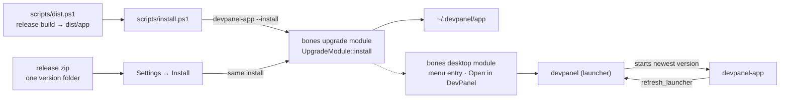

# Installation

DevPanel installs the way Commits does: a permanent launcher plus version folders, managed by bones: `bones-launcher` for the launcher and the kernel's upgrade module for installing. A new build never overwrites the one that is running, and the previous version stays available as a fallback.

## Layout

```text
~/.devpanel/app/                 (DEVPANEL_INSTALL_DIR overrides it)
  devpanel(.exe)                 launcher: the name users and menu entries run
  0.1.0/                         a version folder
    devpanel-app(.exe)           the app
    devpanel-launcher(.exe)      the launcher that shipped with this version
    companions/                  the bundled Commits release (ADR-003)
      commits-<platform>.json    Commits' own update manifest, unchanged
      commits-<v>-<platform>.zip the archive it names, unchanged
  0.1.0-bdfbbcec/                a newer build of the same version, told apart by a content hash
```

Only the newest two version folders are kept. The workspace (repositories, tools, settings) lives in the user's config folder, outside the install, so it survives every update.

## How the pieces meet



- **`dist.ps1`** builds in release mode and assembles `dist/app` in the layout above, so `dist/app/devpanel` runs straight from a build.
- **`install.ps1`** runs `dist.ps1`, then asks the built app to install itself with `devpanel-app --install`. With nothing installed, that places the launcher and the first version folder. With an install present, it adds a new version folder next to the running one, and the launcher switches to it on its next start. The same `--install` then registers DevPanel with the desktop through bones: a `.desktop` entry and an "Open in DevPanel" folder action on Linux, a Start menu shortcut and an Explorer folder verb on Windows, all pointing at the installed launcher with the 256 px icon. A registration that fails prints a warning and the install still succeeds.
- **Settings → Installation** runs the same install from inside the app. It offers **Install** whenever the running build is not the installed one — a build started from an unzipped release, from `dist/app`, or by `cargo run` — and reports what the install did. **Register** and **Unregister** appear only once an install exists, since a registration always points at the installed launcher and is useless without it.
- **The launcher** starts the newest version folder's app and exits. It forwards its arguments untouched, answers `--version` itself, and with `--previous` first starts the previous version instead, for recovery.
- **The app**, at every start from an install, replaces the launcher at the install root with the one that shipped in its own version folder, if they differ. That is how a launcher fix reaches an existing install: the launcher cannot replace itself.

The install logic is the bones upgrade module's Rust, called by the app, not a script that mirrors it, so there is one implementation of version naming, hashing and pruning.

## The release zip

A release zip holds one version folder's contents at its root, the same layout Commits ships:

```text
devpanel-<version>-<platform>.zip
  devpanel-app(.exe)             the app: run it straight from the unzipped folder
  devpanel-launcher(.exe)        the launcher an install places at the install root
  companions/                    the bundled Commits release
  LICENSE
```

Unzipped, `devpanel-app` runs as it is; its **Install** button, or `devpanel-app --install`, installs it, taking the launcher from `devpanel-launcher`. The same zip is the update payload: the upgrade module extracts it straight into a new version folder, so a release needs no second archive.

## Commits comes along

Each version folder carries the Commits release pinned by `COMMITS_VERSION` in `.cargo/config.toml` ([ADR-003](adr/ADR-003-commits-is-a-bundled-companion.md)). After installing DevPanel, `--install` hands that archive and its checksum to the bones upgrade module's companion install, with Commits' own identity (`~/.commits/app`, `COMMITS_INSTALL_DIR`). The policy is *if absent*: when Commits is installed at any version, newer or older, it is left alone and the install says so, because Commits updates itself. A failure prints a warning and DevPanel's install still succeeds. Removing DevPanel leaves Commits installed.

A build without a `companions/` folder, such as `cargo run`, skips this silently. `dist.ps1` fills the folder through `scripts/fetch-commits.ps1`, which caches downloads in `.artifacts/commits/` and fails on a checksum mismatch; offline, a local `dist.ps1` warns and assembles without Commits.

## Updating

At each start DevPanel asks the bones upgrade module whether the latest GitHub release of `an-dr/dev-panel` has a newer `devpanel-<platform>.json` manifest. When it does, Settings shows a quiet "Update to X" beside the version, and nothing else changes. Clicking it downloads and verifies that release's zip into a new version folder; the launcher starts it next time. DevPanel never installs an update without that click. Settings also has "Check for updates" to ask again.

Releases publish those manifests from 0.4.0 on (see [ci.md](ci.md#artifacts-and-releases)); an install older than that updates by installing a new release by hand.
