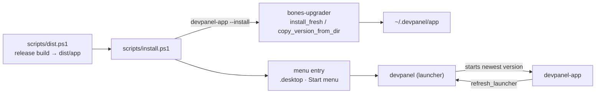

# Installation

DevPanel installs the way Commits does: a permanent launcher plus version folders, managed by bones' `bones-upgrader`. A new build never overwrites the one that is running, and the previous version stays available as a fallback.

## Layout

```text
~/.devpanel/app/                 (DEVPANEL_INSTALL_DIR overrides it)
  devpanel(.exe)                 launcher: the name users and menu entries run
  devpanel.svg                   icon used by the menu entry
  0.1.0/                         a version folder
    devpanel-app(.exe)           the app
    devpanel-launcher(.exe)      the launcher that shipped with this version
    devpanel.svg
  0.1.0-bdfbbcec/                a newer build of the same version, told apart by a content hash
```

Only the newest two version folders are kept. The workspace (repositories, tools, settings) lives in the user's config folder, outside the install, so it survives every update.

## How the pieces meet



- **`dist.ps1`** builds in release mode and assembles `dist/app` in the layout above, so `dist/app/devpanel` runs straight from a build.
- **`install.ps1`** runs `dist.ps1`, then asks the built app to install itself with `devpanel-app --install`. With nothing installed, that places the launcher and the first version folder. With an install present, it adds a new version folder next to the running one, and the launcher switches to it on its next start. The script then adds the application-menu entry on Linux or the Start menu shortcut on Windows.
- **The launcher** starts the newest version folder's app and exits. It forwards its arguments untouched, and answers `--version` itself.
- **The app**, at every start from an install, replaces the launcher at the install root with the one that shipped in its own version folder, if they differ. That is how a launcher fix reaches an existing install: the launcher cannot replace itself.

The install logic is bones-upgrader's Rust, called by the app, not a script that mirrors it, so there is one implementation of version naming, hashing and pruning.

## Not yet

- **Updates from a hosted release.** bones-upgrader can fetch a manifest and install a downloaded zip; DevPanel has no release feed yet, so updating means running `install.ps1` again.
- **"Register with system" from inside the app** (file-manager "Open in DevPanel" verbs, as Commits has). The install script's menu entry covers starting the app. See [VERIFY.md](../VERIFY.md).
