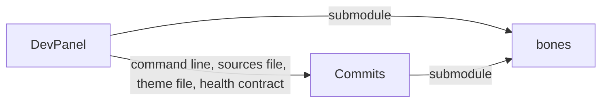
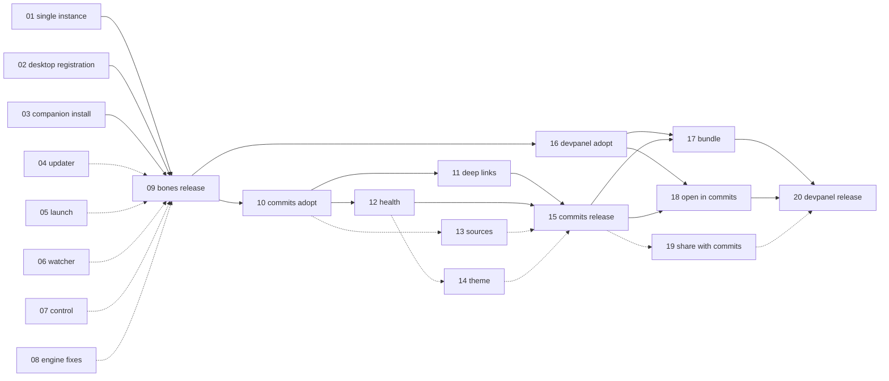

# Commits integration: work plan

Briefs for the agents that implement the DevPanel–Commits integration across three repositories. Each numbered file is one feature for one repository. Do them in number order. A brief lists what it depends on, and nothing may start before its dependencies are released.

## The goal

[Commits](https://github.com/an-dr/commits) becomes DevPanel's git client:

- **One click.** Any repository DevPanel tracks opens in Commits from its card.
- **One window.** Opening a second repository reuses the running Commits window.
- **Straight to the fix.** A problem DevPanel reports, such as conflicts or uncommitted changes, opens in the Commits view where it is fixed.
- **Same problems, same look.** Commits shows the same problems, in the same words and colours.
- **Installed together.** DevPanel ships Commits, so this all works right after installing DevPanel.

## Architecture

### Dependencies point one way

- **DevPanel depends on Commits, never the reverse.** Commits is a general git client with several callers: a shell, a file-manager verb, a VS Code extension, DevPanel. DevPanel is one integrator among them. By the stable-dependencies principle the integrator depends on the general component. Commits' code, docs and tests never name DevPanel except as an example caller.
- **Every contract between the apps is owned by Commits** ([00-contracts.md](00-contracts.md)). DevPanel conforms to Commits' contracts and supplies data in Commits' formats: a repository list, a theme file, and launch arguments. Commits never reads a DevPanel file or a DevPanel document.
- **No code is shared between the apps.** They meet only through Commits' command line and two Commits-defined JSON files. Health rules are implemented twice, in Rust and TypeScript, and held together by one set of conformance vectors that Commits publishes. This is the same technique Commits' ADR-002 already uses for its wire contract.
- **Both apps depend on bones, and bones depends on neither.** The rule is Commits' ADR-012: a capability that does not need a git repository goes into bones first and reaches the apps through a submodule bump.

### Where new bones code goes

bones' own layering ([structure.md](https://github.com/an-dr/bones/blob/main/docs/architecture/structure.md), ADR-030, ADR-031, ADR-034) decides every placement. The briefs apply one pattern:

| Layer | What goes there | May depend on |
| --- | --- | --- |
| **Leaf library**, `crates/bones-<name>/`, like `bones-upgrader` | The capability itself, as plain Rust with no bus | std and third-party crates only; no other bones crate |
| **Message vocabulary**, `bones-messages::<name>` | Typed request and result messages, only when something on the bus needs them | nothing; it is the shared contract on the ABI line |
| **Native module**, `crates/bones-engine/bones-module-<name>/` | A thin bus adapter over the leaf library | `bones-kernel`, `bones-messages`, its leaf library; never another `bones-module-*` crate |
| **Composition root**, `bones-engine` | A feature flag and a builder method that registers the module | the modules it composes |

Two consequences matter for the apps:

- **An app's inner layers use the leaf library directly, not the bus.** DevPanel's `devpanel-infra` adapters implement ports in `devpanel-core` and do not speak the bus; only `dashboard.rs` does. A bones capability that DevPanel's infra needs must therefore exist as a leaf library, and a bus module is added only when a page or a WASM guest needs it.
- **No module is added without a consumer.** Each brief says who calls each new surface. A bus module with no caller is speculative and stays out (YAGNI).

### Decisions already taken

Do not reopen these in a brief. Each is the plan's answer to an architecture question.

| Decision | Why |
| --- | --- |
| Single instance is a leaf crate `bones-instance` plus a module `bones-module-instance` | The claim must run in `main` before the engine builds a window, so it cannot be a module alone. The delivery of later launches is bus traffic, so it is a module. |
| `bones-instance` takes a plain key string, not `AppIdentity` | Avoids coupling single instance to self-update. Apps pass `host_identity().app_stem`. |
| Desktop registration is a leaf crate `bones-desktop` plus a module `bones-module-desktop` | It is a separate capability from self-update (single responsibility), and ADR-034 already anticipates splitting OS capabilities into per-capability modules. `bones-upgrader` does not depend on it; an app's `--install` calls both. |
| Program launching is a leaf crate `bones-launch`, with no bus actions | Both consumers are native code: DevPanel's `SystemLauncher` adapter and Commits' `repo-os` module. A guest-facing "start any program" action would be a large trust-boundary widening (ADR-034) with no caller. |
| The folder watcher is a leaf crate `bones-watch`, with no bus module | Both consumers are native: Commits' `crates/watcher` and an optional DevPanel adapter. Each keeps its own topics and path meaning. |
| The updater bus module is `bones-module-upgrader`, over `bones-upgrader` | The leaf crate stays free of HTTP and the bus. The module owns an HTTPS `Fetch` implementation that moves from Commits' `release.rs`, so it never depends on `bones-module-os`. |
| The display-backend fix selects X11 without touching the process environment | Then a child process inherits the user's environment unchanged, and no "restore the originals" helper or coupling between the web module and launching is needed. |
| Commits owns the health verdicts, the repository-sources format and the theme-file format | Dependencies point one way: see above. DevPanel's current verdict table moves to Commits unchanged, as the draft in 00-contracts. |

## How to hand a brief to an agent

1. Open a session in the target repository: `bones`, `commits` or `dev-panel`.
2. Give the agent the brief, [00-contracts.md](00-contracts.md) and this README's **Architecture** section.
3. The agent follows that repository's own `AGENTS.md` for workflow, branches, commits and tests. A brief says what to build and where it sits, not how that repository works.
4. A brief names files and functions that existed on 2026-10-12. Where one has moved, the agent finds its successor and continues; it stops to ask only when a decision in the table above would have to change.

## Order

| # | Repository | Feature | Integration |
| --- | --- | --- | --- |
| 01 | bones | [Single instance with argument handoff](01-bones-single-instance.md) | required |
| 02 | bones | [Desktop registration](02-bones-desktop-registration.md) | required |
| 03 | bones | [Companion app install](03-bones-companion-install.md) | required |
| 04 | bones | [Updater module and GitHub release source](04-bones-updater-module.md) | recommended |
| 05 | bones | [Launch programs and terminals](05-bones-launch-programs.md) | recommended |
| 06 | bones | [Folder watcher](06-bones-folder-watcher.md) | optional |
| 07 | bones | [Loopback control channel](07-bones-control-channel.md) | optional |
| 08 | bones | [Engine fixes: panel serving and Wayland](08-bones-engine-fixes.md) | optional |
| 09 | bones | [Release](09-bones-release.md) | required |
| 10 | commits | [Adopt the new bones, and the launch request](10-commits-adopt-bones.md) | required |
| 11 | commits | [Deep links](11-commits-deep-links.md) | required |
| 12 | commits | [Repository health contract and line](12-commits-health-line.md) | required |
| 13 | commits | [Repository sources in the selector](13-commits-repository-sources.md) | recommended |
| 14 | commits | [Theme flags and theme files](14-commits-theme.md) | recommended |
| 15 | commits | [Release](15-commits-release.md) | required |
| 16 | dev-panel | [Adopt the new bones](16-devpanel-adopt-bones.md) | required |
| 17 | dev-panel | [Bundle Commits](17-devpanel-bundle-commits.md) | required |
| 18 | dev-panel | [Open in Commits](18-devpanel-open-in-commits.md) | required |
| 19 | dev-panel | [Share repositories and health rules with Commits](19-devpanel-share-with-commits.md) | recommended |
| 20 | dev-panel | [Release](20-devpanel-release.md) | required |

**required** is the shortest path to the goal. **recommended** makes the result noticeably better. **optional** can ship later without blocking anything. A bones release (09) includes whatever optional items are done by then. The rest go in a later bones release and a later bump.

## Dependencies

DevPanel 16 can run in parallel with Commits 10–15: it needs only the bones release. Brief 14 depends on 12 because the theme file carries the urgency colours that 12 introduces. Nothing in bones depends on an app, and nothing in Commits depends on DevPanel, so the graph has no cycle.
